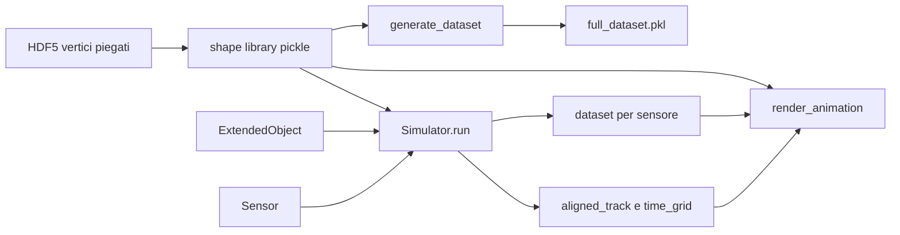

# Architettura di TNS-2D

TNS-2D separa i dati di scenario dalla procedura che li fa evolvere. `ExtendedObject` e `Sensor` sono contenitori. `Simulator` integra le traiettorie, le allinea e riempie i dataset dei sensori. Il renderer legge solo lo stato già calcolato e non modifica la simulazione.



## Pipeline di `Simulator.run`

Tre passi, nello stesso ordine stampato a video.

1. **Traiettoria grezza.** Per ogni oggetto, `_generate_raw_trajectory` integra la dinamica dal tempo proprio 0 fino a `max_duration`, con passo `extended_object.dt`. Il risultato è `raw_time` (tempo proprio più `t_init`) e `raw_track` di forma `(4, K_raw)`.
2. **Allineamento.** `_align_all_tracks` cancella i campioni usciti dal quadrato, sceglie la finestra temporale comune e ricampiona ogni traccia su `time_grid`.
3. **Misure.** `_generate_all_datasets` percorre i sensori e, a ogni scansione attiva, accumula clutter e rilevazioni.

## Dinamica

Lo stato è `[x, y, prua, velocità]`. Il comando è `[a_lon, a_cen]`: accelerazione longitudinale e accelerazione centripeta, in m/s².

Il comando è costante a tratti. `_zoh_interpolator` assegna a ogni istante il valore il cui tempo di attivazione è l’ultimo `≤ t` (`searchsorted` con `side='right'`, indice tagliato a zero). Un istante precedente al primo breakpoint riceve comunque il primo valore. I vettori `long_*` e `centr_*` sono indipendenti: possono cambiare in istanti diversi.

Un passo di integrazione (`_zoh_integrator`) tiene il comando fermo sull’intervallo e aggiorna lo stato in modo trapezoidale:

- `v⁺ = v + dt · a_lon`, poi la velocità usata per la posizione è la media tra `v` e `v⁺`
- `prua_dot = a_cen / v` se `|v| > 1e-6`, altrimenti 0
- la prua nuova è avvolta in `[-π, π)` con `arctan2(sin, cos)`
- la posizione avanza con velocità media e prua media: `x⁺ = x + dt · v_media · cos(prua_media)`, e analogamente per `y`

È il modello a uniciclo. Non ci sono limiti su velocità, accelerazione o raggio di virata: un `a_cen` grande con velocità bassa produce una prua che gira in fretta. La velocità può diventare negativa se `a_lon` resta frenante.

## Finestra temporale e griglia

Il teatro è il quadrato `[-spine_length, spine_length]²`. Ogni campione grezzo con `|x|` o `|y|` fuori da quel quadrato diventa `NaN` sull’intera colonna di stato.

La griglia comune parte dal minimo `raw_time` e arriva al minimo tra `max_duration` e l’ultimo istante ancora dentro al quadrato, con passo `global_dt`:

```text
time_grid = arange(t_start, final_t_end + global_dt, global_dt)
```

Ogni traccia valida è depositata sull’indice `searchsorted(time_grid, t, side='left')`. Se più campioni grezzi cadono nello stesso bin, resta il primo. I buchi di un solo `NaN` sono interpolati in lineare con pandas (`limit = 1`); i buchi più lunghi restano `NaN` e l’oggetto risulta assente. Dopo l’interpolazione la prua è di nuovo avvolta in `[-π, π)`.

`aligned_track` ha forma `(4, K)` con `K = len(time_grid)`. Le righe sono `x`, `y`, prua, velocità.

Conseguenza pratica: `extended_object.dt` e `global_dt` vanno tenuti commensurabili. Nello scenario di esempio sono uguali (`1/120` s), quindi l’allineamento è quasi una copia dei campioni interni al quadrato.

## Modello di sensore

Il sensore è fisso. Tre frame compaiono nei calcoli:

- **Mondo.** Origine arbitraria, asse +x verso heading 0.
- **Oggetto.** Origine nella posizione dell’oggetto, asse +x lungo la prua. La trasformazione è la rototraslazione `_roto_translate`.
- **Sensore.** Origine nella posizione del sensore, asse +x lungo la prua (boresight). Bearing e range sono calcolati in questo frame.

La matrice di rotazione, per una prua `h`, è `[[cos h, -sin h], [sin h, cos h]]`. `inverse=True` applica la trasposta e sottrae la traslazione prima di ruotare.

### Quando una scansione esiste

Per il sensore `s` gli indici sulla griglia sono

```text
start = round(t_offset / global_dt)
step  = round(dt_sample / global_dt)
indici = start, start+step, start+2·step, ...
```

Su questa sequenza si costruisce `dropout_sequence`. Una scansione con valore `≤ 0.5` non produce né rilevazioni né clutter e non entra in `dataset['times']`.

Due modelli, scelti da `alpha`:

- **`alpha is None`.** Bernoulli indipendente a ogni scansione. Probabilità di scansione attiva uguale a `pd`. Il codice pesca `{0, 1}` con probabilità `{1-pd, pd}`.
- **`alpha` numerico.** Catena di Markov a due stati. `1` è attivo, `0` è dropout. Se attivo, resta attivo con probabilità `alpha`. Se in dropout, resta in dropout con probabilità

```text
beta = (1 - 2·pd + pd·alpha) / (1 - pd)
```

quando `1 - pd` non è trascurabile, altrimenti `beta = 0`. Il primo stato è attivo con probabilità `pd`. In questo modello `pd` è la probabilità marginale di attività che la formula di `beta` cerca di realizzare; `alpha` è la persistenza dello stato attivo. `beta` è la probabilità di **restare** in dropout. Il recupero è `1 - beta`.

`pd` non assottiglia i singoli punti. Quando la scansione è attiva, `dropout_status` vale 1 e il processo di Poisson usa l’intensità piena.

Il generatore di dropout accetta un `seed`, ma il simulatore lo chiama senza seme: le sequenze non sono riproducibili. Clutter e punti misurati usano il generatore globale di NumPy (`np.random`), anch’esso non fissato.

### Clutter

A ogni scansione attiva il numero di falsi allarmi è Poisson di media `clutter_rate · area`, dove l’area è il settore anulare del campo di vista:

```text
area = 0.5 · (max_range² - min_range²) · (max_bearing - min_bearing)
```

I punti sono uniformi in `r²` fra i due range e uniformi in bearing, poi portati nel frame mondo. L’etichetta è `-1`.

### Modalità `contour`

Per ogni spigolo del `contourShapeMatrix`:

1. Il centro dello spigolo è trasformato nel frame sensore.
2. Se `use_oor` è vero, lo spigolo conta solo se quel centro cade in range e in bearing.
3. Se `use_los` è vero ed esiste `LoSTable`, lo spigolo conta solo se il punto di griglia più vicino al sensore (nel frame dell’oggetto) marca quello spigolo come visibile.
4. L’intensità è `lambda_i = resolution · lunghezza · los · oor · dropout_status`.

Il numero totale di punti è Poisson di media `Σ lambda_i`. Ogni punto sceglie uno spigolo con probabilità proporzionale a `lambda_i`, cade uniforme sullo spigolo e riceve rumore gaussiano isotropo di scarto `sigma_v`. L’etichetta è `identifier` dell’oggetto.

La visibilità è una approssimazione: si testa il **punto medio** dello spigolo. Un segmento dal sensore a quel punto medio che interseca un altro spigolo rende lo spigolo occluso. Non è la frazione visibile dello spigolo.

### Modalità `surface`

Stesso schema sul `surfaceShapeMatrix`. Ogni colonna è un triangolo; l’intensità usa l’area (riga 6) al posto della lunghezza:

```text
lambda_i = resolution · area · oor · dropout_status
```

Il punto è uniforme nel triangolo con le coordinate baricentriche di Kraemer: dati `u1, u2` uniformi in `[0, 1]`,

```text
p = (1 - sqrt(u1)) · v0 + sqrt(u1) · (1 - u2) · v1 + sqrt(u1) · u2 · v2
```

poi si somma il rumore `sigma_v`. Il flag `use_los` è ignorato: la superficie non consulta `LoSTable`. Il test di campo di vista usa il baricentro del triangolo.

### Modalità `center`

Un solo punto, il baricentro dei punti medi degli spigoli pesato con la lunghezza. Se il centro è nel campo di vista (quando `use_oor` è vero) e la scansione è attiva, si emette quel punto più rumore `sigma_v`. Altrimenti nessun ritorno. `resolution` e `use_los` non entrano nel calcolo.

### Cosa finisce in `sensor.dataset`

```python
{
    "times": np.ndarray,              # istanti di time_grid con almeno un punto
    "measurements": list[np.ndarray], # ciascuno (N_k, 2), frame mondo
    "labels": list[np.ndarray],       # ciascuno (N_k,), int
}
```

Clutter e rilevazioni della stessa scansione sono impilati nello stesso array. L’ordine è: prima il clutter del sensore, poi gli oggetti nell’ordine della lista `extended_objects`.

## Libreria di sagome

Un elemento della lista pickle:

| Chiave | Contenuto |
|---|---|
| `fullName` | Nome letto dall’attributo HDF5 `name` |
| `shortName` | Identificativo letto dall’attributo HDF5 `id` |
| `contourShapeMatrix` | `float`, forma `(5, n)`. Colonna = spigolo: righe 0–1 inizio, 2–3 fine, 4 lunghezza |
| `surfaceShapeMatrix` | `float`, forma `(7, m)`. Colonna = triangolo: vertici `(v0, v1, v2)` su tre coppie di righe, area sulla riga 6 |
| `LoSTable` | Dizionario `coords`, `flags`, `meta` |

`contourShapeMatrix` è un anello chiuso e ordinato. Il renderer e il dataset disegnano il poligono con i soli punti iniziali degli spigoli (righe 0–1), quindi l’ordine delle colonne è l’ordine del bordo.

Per le 21 sagome in repository, `m = n - 2`: sono poligoni semplici senza buchi. Il contorno va da 12 spigoli (B-2) a 112 (A380 e Spitfire).

`LoSTable`, identica nei parametri per ogni sagoma:

| Campo | Valore in repository |
|---|---|
| `coords` | `(3939, 2)`, punti nel frame dell’oggetto |
| `flags` | `(3939, n)`, `uint8`, 1 visibile e 0 occluso |
| `angleResolution` | 10° |
| `rangeResolution` | 10 m, usata per decidere **quanti** anelli |
| `minimumRange`, `maximumRange` | 2 m, 75 m |
| `rangeDensity` | 3, addensa gli anelli verso il raggio minimo |
| `totalGridPoints` | 3939 |

Gli anelli non sono equispaziati. Il raggio j-esimo è

```text
r = r_min + (r_max - r_min) · (exp(density · j / n) - 1) / (exp(density) - 1)
```

Su ogni anello i punti sono spaziati in arco di circa `r_min · angleResolution`, così la densità tangenziale resta simile anche lontano dall’oggetto.

In simulazione la posa del sensore è portata nel frame dell’oggetto e si prende la riga di `flags` del punto di griglia più vicino in norma euclidea. La tabella è quindi una quantizzazione della direzione e della distanza di osservazione, calcolata una volta per sagoma.

### Da HDF5 a matrici

`foldedVertices` è una metà della pianta, simmetrica rispetto all’asse longitudinale. `unfold` specchia la coordinata trasversale, `circularClip` chiude gli spigoli, `shapeVector` scrive le coordinate di inizio e fine, l’ultima riga è la lunghezza.

La superficie è una triangolazione vincolata del poligono (`triangle` con flag `'p'`): i lati del contorno sono segmenti obbligati. L’area è la formula del laccio, in valore assoluto.

Il sorgente HDF5 non va modificato a mano se si vuole restare compatibili con `generate_shape_library.py`: ogni gruppo di primo livello deve esporre `foldedVertices` e gli attributi `name` e `id`.

## Dataset di classificazione

`generate_dataset.py` non è un secondo motore. Per ogni esempio costruisce un `ExtendedObject` fermo (`initial_speed = 0`, comandi nulli), un `Sensor` in modalità `contour` con portata 0–1000 m e bearing `[-π, π]`, clutter nullo, `pd = 1`, `alpha = None`, e un `Simulator` con `use_dropouts = False` e `use_oor = False`. Il passo `DELTA_T = 1e-6` s serve solo a ottenere uno snapshot.

La posa è casuale: angolo uniforme, prua uniforme, distanza fissa oppure raggio uniforme in area sull’anello. La nuvola della prima misura, se esiste, è trasformata nel frame dell’oggetto con la rototraslazione inversa quando `USE_EXTENDED_OBJECT_COORDINATES` è vero. In quel frame la sagoma resta quella della libreria e l’informazione di posa sopravvive solo in `sensor_pos_eoc`.

Il pickle è `{"metadata": {...}, "data": [esempio, ...]}`. I nomi dei campi della copia in `output/` sono quelli della revisione precedente; il contratto dello script attuale è descritto nel README.

## Renderer

`render_animation` è una `FuncAnimation` di Matplotlib salvata con `FFMpegWriter` (`libx264`, pixel format `yuv444p`, `-crf 0`, preset `veryslow`).

Preparazione, una tantum:

- le tracce allineate diventano un tensore `poses` di forma `(4, K, n_oggetti)`
- i livelli di censura diventano alpha: `null → 1`, `mild → 0.3`, `total → 0`
- per ogni sensore, una mappa da indice di `time_grid` a indice dentro `dataset['measurements']`
- il passo tra frame video è `round((1/FPS) / global_dt)`, almeno 1

A ogni frame:

- il poligono dell’oggetto è il contorno ruotato e traslato con la posa corrente; se `x` è `NaN` il poligono si nasconde e la traccia si interrompe
- la traccia è una `LineCollection`. Ogni tre frame i segmenti contigui vengono fusi e, oltre 300 segmenti, la metà più vecchia è semplificata con Ramer–Douglas–Peucker a tolleranza 0.5 m
- il campo di vista è un `Wedge` tra `min_range` e `max_range`, disegnato solo se l’alpha del sensore è positivo
- clutter (marker `.`) e rilevazioni (marker `s`) restano visibili per 1,5 s con decadimento esponenziale di costante 3 sulla frazione di età

Il colore di una rilevazione è il colore del sensore che l’ha generata, non il colore dell’oggetto. L’etichetta non è disegnata.

## Confini del modello

Cose che la pipeline fa, e che conviene non leggere oltre il codice:

- Un solo teatro quadrato, sensori fissi, niente terreno né multipath.
- L’occlusione è solo propria (uno spigolo dell’oggetto ne copre un altro). Un oggetto non maschera un altro oggetto.
- Il dropout è di scansione, non di punto.
- `surface` e `center` non applicano la linea di vista.
- Il fuori-campo di `contour` e `surface` giudica un punto rappresentativo (centro spigolo o baricentro), non l’intersezione fra geometria e settore.
- Non c’è seme globale: due esecuzioni dello stesso scenario producono clutter, rilevazioni e dropout diversi. Le traiettorie, essendo deterministiche, restano uguali.
- Il pacchetto non ha API di serializzazione dello scenario. L’unico risultato persistente della simulazione interattiva è l’MP4; traiettorie e dataset dei sensori restano in memoria negli oggetti passati a `run`.
